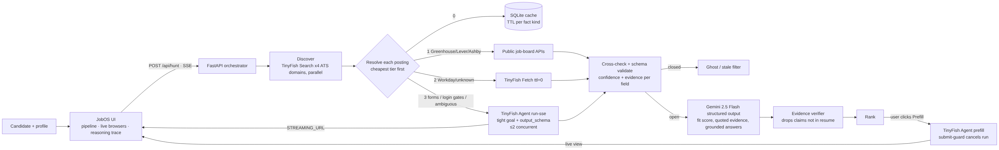
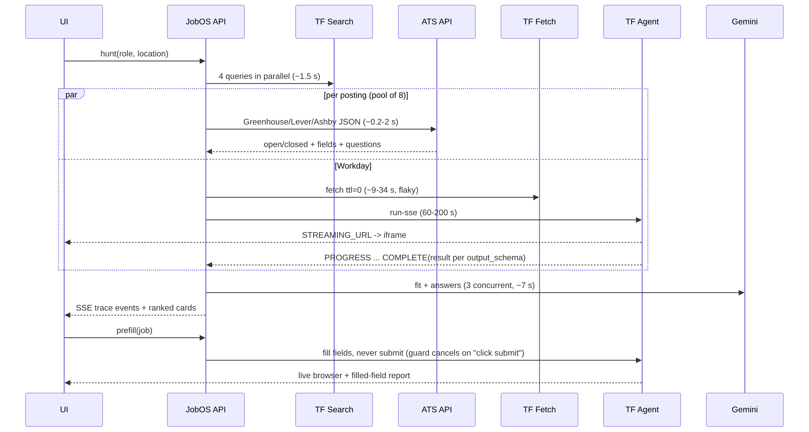

# JobOS Careers Finder: current plan (TinyFish × DTU)

**Status (Oct 2026):** the project moved from the original "verified job hunting + prefill" plan (kept below for history) to the DTU Careers Finder brief. What ships today:

| Layer | What it does |
|---|---|
| Company boards | Greenhouse, Lever and Ashby public APIs (22 boards), refreshed through a cache |
| TinyFish Search | Long-tail `site:` discovery on ATS domains, plus per-tenant Workday discovery for NVIDIA and Walmart |
| TinyFish Fetch | Reads Google Careers. Verifies every non-API link (10 per call, `ttl=0`, one retry for thin pages). Reads the location from the page |
| TinyFish Agent | Workday filtering only (keyword URL, location filter on cards, real link copied from each card). Every Agent link is checked by Fetch plus a title match. Cached 24 h, under about $0.40 per uncached search |
| Matching | Deterministic score (title terms, location, keywords, skills, type, seniority, posted-within) with a "Why this match" breakdown. Gemini is used only for the optional "Explain" button |
| Insights | Skill demand, skill gap, companies and cities (`backend/insights.py`, after job-market-intel, MIT) |
| Tracker | SQLite `track` table, Saved → Applied → Interview → Offer / Rejected |
| Freshness | `first_seen` / `last_verified`, "new since last run", Refresh, 3 h scheduler |

**Next steps:**
- More Workday tenants found automatically through Search.
- Use the Agent's step screenshots to auto-diagnose empty runs.
- TinyFish Monitor for jobs the user has saved.

---

## Original plan (history)

**One line:** JobOS finds roles across the fragmented ATS web (Greenhouse, Lever, Ashby, Workday). It **proves each posting is still live**, scores fit with **quoted evidence**, and then **prefills the real application form in a live cloud browser, stopping before Submit**. Every fact shows its source, a confidence score and a cross-check.

## 1. Pain point (first principles)
A job seeker's real cost is not *finding* listings. It is the **wasted applications**, and three facts drive that waste:

| Evidence | Source |
|---|---|
| 18–22% of jobs posted on Greenhouse in any quarter are "ghost jobs" (no hiring activity) | Greenhouse 2024 State of Job Hunting, https://www.greenhouse.com/blog/greenhouse-2024-state-of-job-hunting-report |
| 60% of candidates suspect they met a ghost job, and 29% applied anyway | same report (2,500 workers, US/UK/DE) |
| 39% of hiring managers say their company posted a fake listing in the past year | Resume Builder 2024, via Quartz https://qz.com/one-in-five-job-postings-is-fake-ghost-jobs-1851738201 |
| **Measured by us today:** TinyFish Search returned a Workday URL that Fetch showed was dead ("The page you are looking for doesn't exist"). 1 of 10 search hits in our first hunt was a Greenhouse 404. A Datasite Workday requisition whose URL says "Senior Backend Engineer (Python API)" now shows **"AI Engineer - NYC"** (a re-used requisition) | `data/tinyfish_runs.jsonl`, `bench/labels.json` |

Why this is still unsolved:
* Postings live in **many ATS silos**. Only some of them (Greenhouse, Lever, Ashby) have public read APIs. **Workday**, the largest enterprise ATS, has no documented public API, and its pages are JS SPAs.
* Search indexes and aggregators are **stale by design**, because they cache. Liveness is a fact that has to be checked *now*, at the source.
* Application forms are long and different on every ATS. Workday also puts sign-in or account creation in front of the form.

**Users:** active job seekers who apply to 20–100 roles (new grads, people laid off, career switchers), plus career coaches and bootcamps who run cohorts.

## 2. Features
1. **Multi-ATS discovery.** Four TinyFish Search queries run in parallel (`site:` Greenhouse, Lever, Ashby, Workday). Results are interleaved and deduplicated.
2. **Liveness verification (the ghost filter).** Each posting is checked at its source through the cheapest tier that can answer authoritatively. Closed or stale postings are struck through, with the evidence quoted.
3. **Field-level provenance.** Each fact is stored as `{value, confidence, sources[{tier, value, evidence}]}`. Results are cross-checked across tiers (ATS API, Fetch, Agent, Search title, URL slug). Agreement raises confidence and disagreement lowers it. A mismatch between URL slug and title flags a re-used requisition.
4. **Grounded fit reasoning.** Gemini 2.5 Flash returns structured output: fit 0–100, a verdict, and reasons. Each reason quotes a JD span and a resume span. A verifier then checks that the resume quote really appears in the resume, and claims that fail are marked *unverified*. Drafted answers carry `grounded_in` and `needs_human` (visa, legal and salary questions always go to a human).
5. **Prefill in a live browser.** A TinyFish Agent fills the real ATS form. The UI embeds the live `streaming_url`. The agent **never submits**, and there are three layers of safety (§7).
6. **Visual control room.** A six-stage pipeline with counters, a grid of live browsers, a reasoning trace (one row per decision with *why*), a per-job evidence table, a per-step screenshot filmstrip (`GET /v1/runs/{id}/steps/{stepId}/screenshot`), and a benchmark tab.

## 3. Why TinyFish (and why APIs or scrapers alone can't do it)
| Need | Plain APIs / scrapers | TinyFish feature used |
|---|---|---|
| Workday and unknown career sites: JS SPAs with no public API | `requests` gets an empty shell. Playwright scrapers need per-tenant selectors and break often | **Fetch** renders JS and returns clean markdown for free. **Agent** works from a natural-language goal with no selectors |
| Read the application form behind "Apply" and know when sign-in blocks it | Needs per-ATS click flows | **Agent** with a tight goal plus **`output_schema`** (form_fields[], apply_requires_account) |
| Show the user *what* is happening (trust) | Headless, so nothing to show | **`STREAMING_URL`** SSE event, embedded as an iframe; step screenshots via the API |
| Run many portals at once | You run your own browser fleet | Cloud browsers. Our semaphore respects the 2-concurrent-run limit |
| Discovery across ATS domains | Need a paid SERP API | **Search API** (free, about 1.5 s) |
| Later: logged-in Workday candidate accounts | Storing passwords | **Vault** (`use_vault`, `credential_item_ids`) plus **Browser Context Profiles** (`use_profile`). Designed in but not exercised (see gaps) |
| Later: watch "saved" jobs for closure or edits | Cron plus diffing | **Monitor** (`POST /v1/monitors`, type fetch, `purpose`, `webhook_url`) |

APIs still matter. We use Greenhouse, Lever and Ashby public APIs **first**, because they are free, authoritative and fast. TinyFish covers the long tail those APIs can't reach. That split is the main design decision, and the benchmark (§9) shows it pays off.

## 4. Architecture
   (sources: `diagrams/*.mmd`)

* `backend/tf.py`: raw TinyFish REST (Search, Fetch, Agent run-sse, runs, cancel, wallet). It has retries and honours `Retry-After` on 429 and 503, a global agent semaphore (2), and a JSONL log of every call.
* `backend/resolve.py`: the tiered resolver (cache, then ATS API, then Fetch, then Agent), plus schema validation and the merge/cross-check confidence model.
* `backend/agents.py`: discovery, Gemini matching with the evidence verifier, and prefill with the submit guard.
* `backend/llm.py`: Gemini `generateContent` with `responseSchema` (structured output), 3 concurrent calls, and backoff on 429.
* `backend/cache.py`: SQLite with **freshness rules per fact kind**: liveness 1 h, posting 6 h, search 30 min, form 24 h, match 7 d.
* `backend/app.py`: FastAPI, SSE event stream, and a screenshot proxy. `web/index.html` is the UI.

## 5. Latency budget (first principles: cheapest primitive that answers each fact)
| Step | Primitive | Measured | Budget rule |
|---|---|---|---|
| Discovery | 4× TinyFish Search in parallel | ~1.5–1.8 s total | Search limit is 30 req/min, so 4 per hunt is fine. Results cached 30 min |
| Liveness + fields, Greenhouse/Lever/Ashby | Public ATS JSON | **p50 ≈ 0.2–2.3 s** | Always first. A 404 or absence counts as authoritative *closed* |
| Liveness + JD, Workday/unknown | TinyFish Fetch `ttl=0` | 5–34 s, flaky (`empty_content`, `target_unreachable` seen) | Only when there's no API. If Fetch shows a dead-page phrase, **stop** (saves ~$0.05 and ~60 s) |
| Form / login gate / ambiguous | TinyFish Agent run-sse + `output_schema` | 60–210 s, 2–25 steps | Only when the fact needs interaction. Tight goal, schema, `max_duration_seconds`. At most 2 concurrent |
| Fit + answers | Gemini 2.5 Flash, `thinkingBudget:0` | ~7 s each, 3 in parallel | Cached 7 days per (job, profile) |
| Streaming | SSE to the UI every 0.3 s | Cards appear as each job resolves | API-tier jobs are scored before the agent-tier jobs have even started |

End to end (12 postings, cold): API-tier cards are scored in **under 10 s**. The full hunt, including 3 Workday agent runs, takes ~226 s, all of it streamed. Warm cache: under 2 s.

## 6. Quality model
* **Schema:** `output_schema` follows the docs' subset (top-level object, `nullable` rather than `["x","null"]`, depth ≤ 10, under 64 KB). The result is re-validated locally, and nullish strings ("not available") become `null`.
* **Cross-source checks:** the confidence base per tier is api .97, agent .85, fetch .75, search .5. Each agreeing source adds +0.08 and each disagreeing one subtracts 0.20. URL-slug token Jaccard below 0.34 subtracts 0.25 from title confidence and creates a note.
* **"COMPLETED ≠ success"** (docs FAQ): the agent result is checked for `is_open` and required fields, not just the status.
* **LLM grounding:** each reason must quote the resume, and the verifier marks quotes that aren't found in it.

## 7. Safety (never submit real applications)
1. The goal text forbids clicking any Submit/Send button, signing in, or creating an account.
2. **Submit guard:** every SSE `PROGRESS.purpose` is matched against a regex (click/press … submit). On a match, the backend calls `POST /v1/runs/{id}/cancel` immediately.
3. **Hard interlock:** JobOS never attaches a resume file. Greenhouse requires one, so even an accidental click fails client-side validation.
   *Incident, found and fixed during the build:* on the first prefill run (`cc53a529-…`) the agent logged "Click submit button to check visibility", because the goal had asked it to *report whether a submit button was visible*. The step screenshot shows Greenhouse rejected it ("Resume/CV is required", "This field is required"), so nothing was submitted. We then removed that instruction and added guards 2 and 3. After the fix, the re-run (Enveritas Greenhouse form) filled 5 fields in **49 s / 9 steps** (before: 141 s / 25 steps), made no submit attempt, and returned `submitted=false`.

## 8. Demo script (about 3 min)
1. `./start.sh`, open http://localhost:8300 and click **Hunt** ("backend engineer python", remote, 12).
2. Within ~2 s, 12 postings appear from 4 ATS families. Within ~10 s, Greenhouse/Lever/Ashby cards turn green with fit gauges. The trace explains *why* each was resolved by API ("cheapest + authoritative").
3. **Ghost filtered:** the CodeRoad Greenhouse posting is struck through, with the evidence "Greenhouse API 404", even though Search still lists it.
4. **Wow 1:** Workday cards spin up **live TinyFish browsers** side by side. The trace shows *"Fetch can't read the application form/login gate → Agent with tight goal + output_schema"*.
5. **Wow 2:** a cross-check flags *"title 'AI Engineer - NYC' does not match URL slug 'Senior Backend Engineer Python API' (possible re-used requisition)"*. No scraper or aggregator surfaces this.
6. Open the top job to see the evidence table (per-field sources), quoted JD/resume reasons with "evidence verified" chips, and drafted answers with "needs you" on the visa question.
7. **Wow 3:** click *Prefill*. A live browser fills the real GitLab Greenhouse form (First, Last, Email, Phone, LinkedIn). It stops before Submit, and the UI shows `submitted=false`.
8. Benchmark tab: the measured ablation table.

## 9. Metrics and benchmark
See `bench/results.json`. The table below is regenerated by `scripts/bench_table.py`.

<!--B-->
Measured 2026-10-14 17:42 IST on 12 hand-labelled postings (4 Greenhouse, 3 Lever, 1 Ashby, 4 Workday; 4 closed or ghost). Labels were checked against the live page, the ATS JSON and Workday's page JSON. Latency is wall-clock per posting under realistic concurrency (6 workers, agent semaphore 2), so agent numbers include queueing.

| design | n | p50 | p95 | success | is_open acc | title acc | location acc | agent steps | est. $ | mean conf (right/wrong) |
|---|---|---|---|---|---|---|---|---|---|---|
| **tiered** | 12 | 1.6 s | 118.0 s | 100% | 100% | 100% | 88% | 24 | $0.384 | 0.88/None |
| **fetch_only** | 12 | 5.4 s | 11.1 s | 100% | 83% | 88% | 0% | 0 | $0.0 | 0.75/0.75 |
| **agent_only** | 12 | 149.6 s | 290.3 s | 100% | 100% | 100% | 88% | 98 | $1.568 | 0.85/None |
| **agent_loose** | 4 | 52.5 s | 81.6 s | 0% | 0% | 0% | 0% | 18 | $0.288 | None/0.0 |

Per agent run, excluding queue time: tight goal + output_schema has p50 55.7 s and 8.2 steps on average. Loose goal with no schema has p50 36.3 s and 4.5 steps.

**Ablation findings**
1. **Tiered vs agent-only:** both reach the same accuracy (100% is_open, 100% title). Tiered is about **90× faster at p50** (1.6 s vs 150 s), has a lower p95, and costs about 4× less, because 9 of 12 postings never touch a browser (8 answered by an ATS API, 1 dead Workday page short-circuited at Fetch).
2. **Tiered vs fetch-only:** fetch-only is faster at the tail but **gets is_open wrong on 2 of 4 closed postings**. Greenhouse redirects a dead job to the company's board page, so Fetch sees a live page titled 'CodeRoad' or 'GitLab'. Only the ATS API 404 (or an agent) catches this. Fetch also returns no structured location.
3. **Tight goal + output_schema vs loose goal without schema:** the loose goal took fewer steps but gave **0% usable fields**, because it returned free-form prose that can't be parsed into the contract. The schema is what makes agent output machine-verifiable.
4. **Confidence calibration:** tiered's mean confidence on correct liveness calls is 0.88. Fetch-only has the same confidence (0.75) whether right or wrong, which shows single-source confidence is uninformative. Cross-checking is what separates them.
5. The one remaining location miss in tiered/agent is the re-used Datasite requisition. The agent returned a description ('NYC (Hybrid…)') instead of the label, and it's flagged with lower title confidence.
<!--/B-->

## 10. Risks
| Risk | Mitigation |
|---|---|
| Agent latency (60–200 s) and cost ($0.016/step) | Agent is the *last* tier. Dead pages short-circuit at Fetch. Results cached. Semaphore of 2 |
| Accidental submit | Three-layer guard (§7). Demo uses fake persona data (`example.com` email) |
| ToS / anti-bot on ATS sites | Read-only, low volume, public pages. `browser_profile: stealth` + proxy available but not needed |
| Stale streaming URLs (docs: may die after the run) | Filmstrip from the step-screenshot API stays available |
| LLM hallucinated fit claims | Evidence verifier. needs_human for legal, visa and salary |
| Fetch flakiness on Workday | Falls back to Agent. Errors are reported per URL in `errors[]` |
| Workday has an undocumented public JSON endpoint (`/wday/cxs/...`) | Used **only** to hand-label the benchmark. Not used in the product, because it's undocumented |

## 11. Docs verification
All pages were downloaded on 2026-10-14 to `docs_ref/` (`llms-full.txt`, 476 KB, plus the individual `.md` pages) and read in full. "Live" means we made a real call with our key today.

| Feature used | Docs URL | Documented behaviour we rely on | How verified |
|---|---|---|---|
| Agent run-sse | https://docs.tinyfish.ai/agent-api/reference | `POST /v1/automation/run-sse`, events STARTED/STREAMING_URL/PROGRESS/HEARTBEAT/COMPLETE, no Last-Event-ID reconnect | **Live:** 20+ runs (e.g. `ed99edb9-…`, `cc53a529-…`). All 5 event types seen |
| `output_schema` | https://docs.tinyfish.ai/key-concepts/structured-output | top-level object, `nullable`, ≤64 KB, depth ≤10, arrays for lists, "schema wins" | **Live:** results matched the schema. Unit test checks our schema follows the rules |
| `agent_config.max_duration_seconds` | agent-api/reference | Not beta-gated (unlike `max_steps` / `mode:strict`, which return 403 for non-beta accounts) | **Live:** accepted. We deliberately don't send `max_steps` |
| `browser_profile: lite` | https://docs.tinyfish.ai/key-concepts/browser-profiles | default lite. Stealth for anti-bot | **Live:** lite worked on Workday and Greenhouse |
| Live view | https://docs.tinyfish.ai/live-preview | iframe the `streaming_url`. It "may become unavailable after the run completes" | **Live:** embedded in UI. Confirmed it goes blank after completion |
| GET run | https://docs.tinyfish.ai/api-reference/runs/get-run-by-id | status, steps[], streaming_url, video_url | **Live** |
| Step screenshot | https://docs.tinyfish.ai/api-reference/runs/get-step-screenshot | `GET /v1/runs/{id}/steps/{stepId}/screenshot` with API key, returns JPEG | **Live:** proxied as filmstrip. Screenshot proved the submit was blocked |
| Cancel run | https://docs.tinyfish.ai/api-reference/runs/cancel-run-by-id | `POST /v1/runs/{id}/cancel`, only for async/sse runs | Read. Wired into the submit guard (guard did not trip after the fix) |
| Search | https://docs.tinyfish.ai/search-api/reference | `GET api.search.tinyfish.ai?query=` → results[{position,site_name,title,snippet,url}]. 30 req/min. Free up to 12,000/day | **Live:** ~1.5 s, `site:` operator works |
| Fetch | https://docs.tinyfish.ai/fetch-api/reference | `POST api.fetch.tinyfish.ai` {urls ≤10, format, ttl}. Per-URL `errors[]`. 150 URLs/min. Free up to 1,000 URLs/day. 110 s backend timeout, so client timeout should be ≥150 s | **Live:** saw `empty_content`, `target_unreachable` |
| Wallet / pricing | https://docs.tinyfish.ai/api-reference/wallet/get-wallet, https://www.tinyfish.ai/pricing | Agent $0.016/step, Browser $0.002/min, Search/Fetch $0. Agent limit 2 concurrent runs, Browser 5 sessions | **Live:** `GET /v1/wallet` rates match the pricing page ($12.92 → see report) |
| Rate limits / errors | https://docs.tinyfish.ai/error-codes | 429 RATE_LIMIT_EXCEEDED + Retry-After. 402 INSUFFICIENT_CREDITS (wallet). COMPLETED ≠ goal achieved | Read. Implemented backoff. Our own result validation |
| Webhooks | https://docs.tinyfish.ai/webhooks | run webhook_url must be HTTPS. Payload has the same shape as GET run | Read only (no public HTTPS endpoint on box) |
| Monitor | https://docs.tinyfish.ai/monitor/api-reference | `POST /v1/monitors` type fetch/search, schedule_cron (UTC), purpose ≤2000, webhook_url | **Live:** `GET /v1/monitors` → `[]`. Create not exercised (no public webhook) |
| Vault | https://docs.tinyfish.ai/key-concepts/credentials | `use_vault`, `credential_item_ids`, domain-matched, 1Password/Bitwarden | **Live:** `GET /v1/vault/connections` → none connected, so not exercised |
| Browser Context Profiles | https://docs.tinyfish.ai/agent-api/browser-context-profiles | `/v1/profiles`, setup-session via CDP, `use_profile`/`profile_id` | **Live:** `GET /v1/profiles` → one default profile, 0 domains |

**Undocumented behaviour or contradictions we found**
1. `GET /v1/runs/{id}` returned `num_of_steps` as a **string** ("3"). The reference types it `integer|null`.
2. The SSE stream gave 3 PROGRESS events, but the run's `steps[]` had 4 entries. Even so, across all 25 runs the wallet went from $12.92 to $9.448 (−$3.47), which matches 217 PROGRESS steps × $0.016 = $3.47 exactly. Billing appears to follow PROGRESS events, not `steps[]`.
3. `video_url` was `null` on every run, although the reference lists it. Recording appears to need `capture_config` (account-gated).
4. Monitor `webhook_url` is documented as "public HTTP **or HTTPS**", while run webhooks "must use https://". The two are inconsistent.
5. The FAQ points to `POST /v1/automation/run-batch`, but the llms.txt index titles it "Start multiple automations asynchronously" without the path. The OpenAPI spec confirms `/v1/automation/run-batch`. Minor.
6. The Search free tier is documented as "12,000 requests per day", while the pricing page says "500 requests / hour". These match daily but not as a burst rule.
7. The Live Preview docs show a `*.unikraft.app` streaming host. We received `*.tetra-data.production.tinyfish.io` hosts, so don't allow-list a single domain.
8. The agent obeyed `output_schema` but returned the string "not available" instead of `null` for missing fields. We normalise these.
9. The SSE COMPLETE event in the docs shows `result` as an object. In the SDK it's `result_json`. Raw REST gave an object (we also handle strings).

