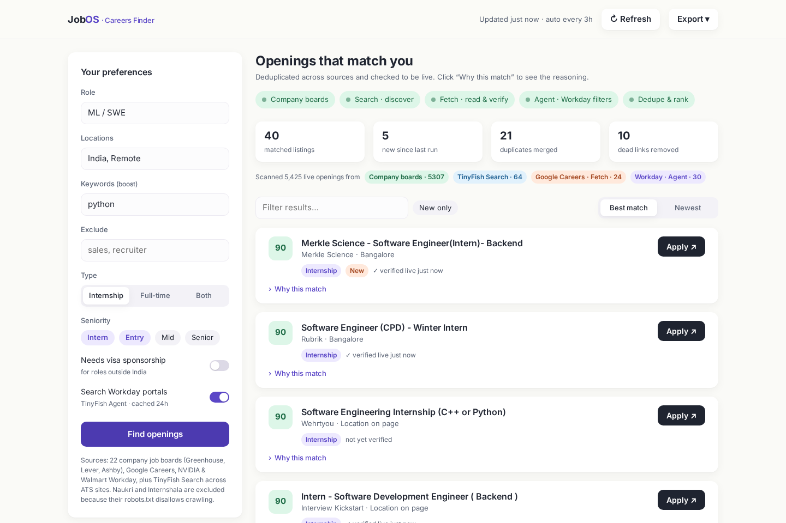
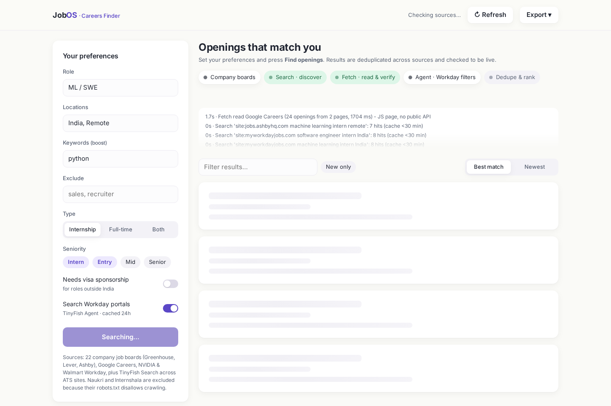
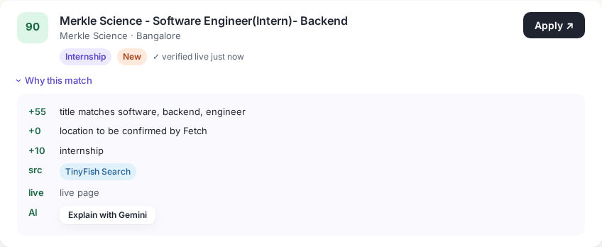

# JobOS: Careers Finder on TinyFish
A live job and internship finder covering company boards, Google Careers, Workday and TinyFish Search. It deduplicates listings, verifies they are live, and keeps them fresh. See **SUBMISSION.md** and **PLAN.md**.

```bash
cp .env.example .env   # add TINYFISH_API_KEY and GEMINI_API_KEY
./start.sh             # creates .venv, serves http://localhost:8300
.venv/bin/python -m pytest -q tests
```



