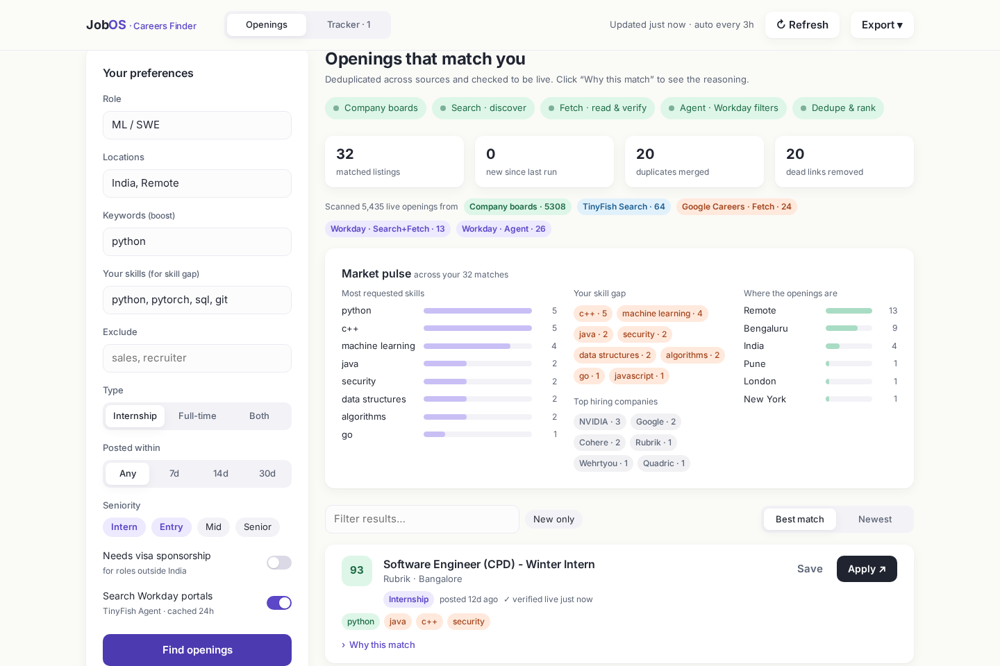
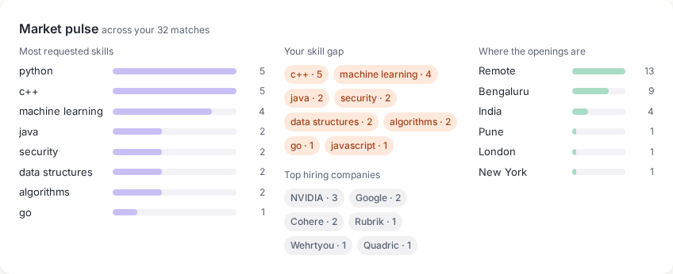
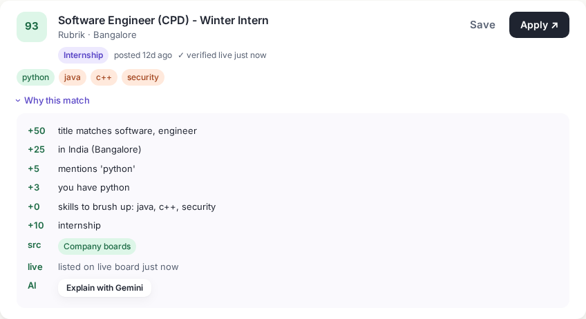
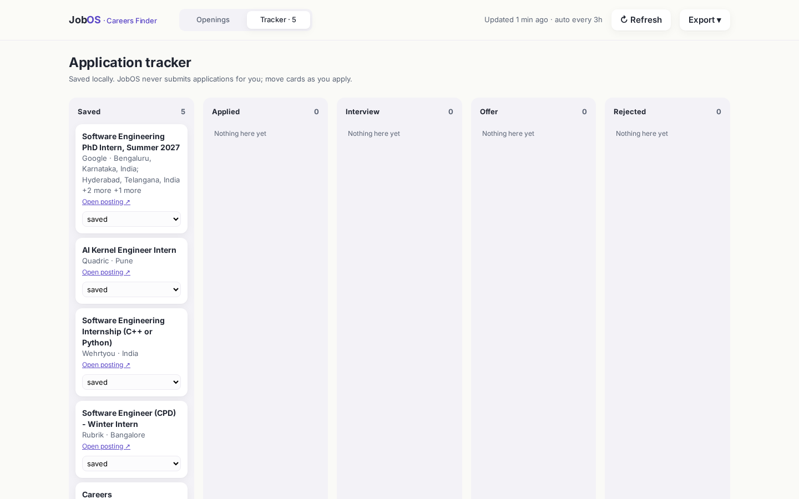

# JobOS: Careers Finder on TinyFish
A live job and internship finder for DTU students. It pulls openings from 22 company job boards, Google Careers, NVIDIA and Walmart Workday, plus TinyFish Search across ATS sites. Listings are deduplicated, checked live, ranked with an explainable matcher, and kept fresh. Details are in **SUBMISSION.md**, design notes in **PLAN.md**, and ideas borrowed from other projects in **docs/LEARNINGS.md**.

```bash
cp .env.example .env   # add TINYFISH_API_KEY (GEMINI_API_KEY optional: "Explain with Gemini" only)
./start.sh             # creates .venv, serves http://localhost:8300
.venv/bin/python -m pytest -q tests
```

## Features
- **Preferences:** role, locations, keywords, your skills, exclude, internship/full-time, seniority, visa sponsorship, posted-within (7/14/30 days).
- **Sources:**
  - Greenhouse, Lever and Ashby public APIs.
  - Google Careers via TinyFish Fetch.
  - Workday (NVIDIA, Walmart) via TinyFish Search plus Fetch, with the TinyFish Agent as a filter pass.
  - Long-tail ATS postings via TinyFish Search.
- **Clean results:**
  - Cross-source identity (gh_jid, Lever/Ashby UUID, Workday JR id) plus a company + title + city key.
  - Every non-API link is Fetch-verified. Thin or empty pages are re-checked once.
  - Agent links whose page title doesn't match are rejected, so the Agent can't add made-up URLs.
- **Location parsing:** Workday URL slugs (`India-Pune`, `IN-KA-BANGALORE`), "Location:" labels and known city names from the fetched page or search snippet.
- **Market pulse:** most-requested skills, your skill gap, top hiring companies and where the openings are.
- **Cards:** skill chips (mint = you have it, peach = missing) and a "Why this match" score breakdown.
- **Tracker:** a board with Saved, Applied, Interview, Offer and Rejected columns. It is stored locally, and JobOS never submits applications.
- **Freshness:**
  - "New since last run" badges and a Refresh button that re-verifies saved listings.
  - Automatic re-run every 3 h.
  - CSV and JSON export.






Screenshots are made with `scripts/shoot_v3.py`, which uses the cached sources and doesn't spend on the Agent.
